# The Magical Camera: design decisions (v0)

Written 11 Nov 2026, alongside v0. This explains what was decided and why, so any of it can be revisited later. Each decision is marked:

- **Yacoub**: decided by Yacoub in the voice design session of 10–11 Nov.
- **Claude**: a call made during the build. Open to change.

Screenshots are in `docs/screens/`. They come from a test browser with a fake camera, which is why the viewfinder shows a green test pattern instead of a street.

---

## 1. Principles

| Principle | Source |
|---|---|
| Eyes off the screen. The phone is an object you carry, not an app you check. | Yacoub |
| Feel like a video game (Professor Layton on DS, Nintendo puzzle games, Wii gestures that feel like a magic trick), not a cheap monetised mobile game or a modern web app. | Yacoub |
| Theme: a magical steampunk camera. Skeuomorphic brass, physical-feeling parts. | Yacoub |
| Restraint. Magic lives in a few slow moments and everything else stays quiet. | Claude, agreed by Yacoub |
| Nothing punishes you. Lowering the camera mid-mount costs nothing. Forgetting to load a roll is fine. | Yacoub (forgiving design, as in Protagonist) |
| Reuse what exists and credit every source. A priority, not a rule. A working demo comes first. | Yacoub |

---

## 2. The loop

Load → walk → unfold → mount → squeeze → wind → pull the roll → darkroom → reflect → develop → hang → drying line.

### 2.1 Taking the camera
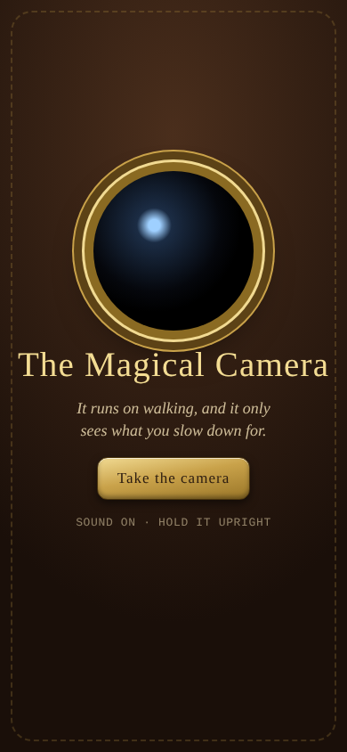

- One brass button, "Take the camera". **Claude.** iPhone Safari only grants motion sensors and the camera from a tap, so the one unavoidable tap is turned into the moment of picking the camera up.

### 2.2 Loading a roll
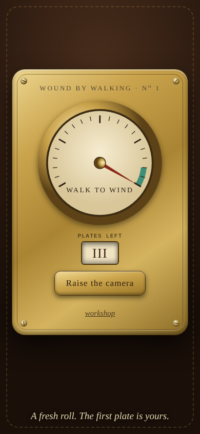

- Hold the canister for 0.6 s to load a fresh roll. A soft four-note chime plays. **Yacoub:** loading a fresh roll is the starting ceremony, marked by a gentle chime.
- If you forget, the camera loads itself the first time you raise it, with the same chime. **Yacoub.**

### 2.3 Unfold and mount
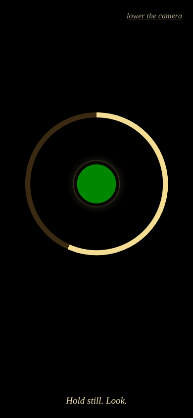 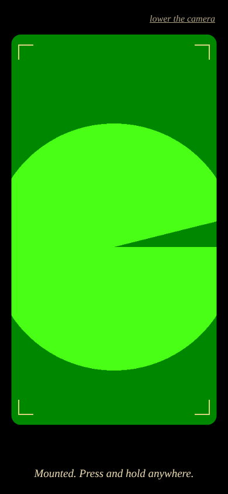

- **Unfold:** raise the phone upright (tilt between 68° and 125°) and hold still for 0.9 s. A wooden creak, then a click. **Claude.** In the voice session we discussed flipping the phone face-up to unfold it. Raising works upright in portrait or sideways like a camera (fixed 11 Nov from Yacoub's sensor recordings). It was chosen because it's more reliable coming out of a pocket and doubles as the start of the mount.
- **Revised 13 Nov (Yacoub): the setup minute is mechanical and needs nothing from you.** Tap "Prepare the camera" (or raise it). For 60 s the screen shows only three dim brass gears turning, with a quiet ambient synth pad underneath: four slow, unresolved chords (Am9, Fmaj7, G6, Em7) gliding every 9 s through a soft low-pass filter, fading in and breathing 4 s in, 6 s out. It's meant to help you reflect, not to tick like something to keep checking (Yacoub, 13 Nov: the clockwork tick felt too mechanical). No ring, no progress, no need to hold still or keep it raised, so you can look at the thing itself. When it's ready: a chime, then the brass ring fills and the iris opens onto the viewfinder (about 3.5 s), then press and hold to shoot. "Put it away" at the top cancels. A small "prepare now" text button, bottom-left, skips the minute for testing. What follows below is the v0 design it replaced.
- **Mount (v0):** 60 s of stillness. **Yacoub** asked for a setup of a minute or two, time to observe mindfully. 60 s is the low end so the first test isn't tedious.
  - A brass ring fills as you hold still.
  - A breathing circle paces 4 s in and 6 s out. **Claude.**
  - A soft tuning-fork tone breathes with the circle and rises in pitch as the mount completes. When you wobble, the tone wavers and the ring shakes. **Claude.**
  - No music, only a faint tone, so you hear the street. **Yacoub.**
- The screen stays black with no live feed until the last 5 s, when an iris opens onto the viewfinder so you can frame. **Claude** (proposed by voice; Yacoub didn't object).
- Once mounted, the view stays a round lens inside the brass ring, and the plate is cropped to that circle's square, so prints are square. **Yacoub** (13 Nov): v0 jumped from the circle to a rounded rectangle, which felt wrong.
- Lowering the phone for 1.1 s folds the camera. No plate is spent. **Claude.**

### 2.4 Shutter and zoom (revised 13 Nov, Yacoub)
- **Shutter:** a round brass shutter button with a dark leather centre, bottom centre. One press fires. It replaces "press and hold anywhere" from v0.
- **Zoom crank:** no pinch. A small brass crank wheel, bottom right, that you turn in a circle with your finger. Clockwise zooms in, anticlockwise out, from 1× to 4×. One full turn is about 0.8×. Each 0.1× step clicks softly, with a heavier click every 0.5×.
- **Haptics (native app, Yacoub):** every zoom step should give a crisp detent tick, like spinning the time wheels when setting an alarm on iPhone (UISelectionFeedbackGenerator, or Core Haptics for the heavier 0.5× notch). The web page can't vibrate on iPhone, so the click sound stands in for it. It vibrates on Android.
- Zoom is digital in v0: the view is scaled and the plate is cropped to match, so heavy zoom gives smaller prints. The page asks for 4K camera frames to compensate. A native app would use the real lens zoom.

### 2.4b The squeeze (v0, replaced)
- Press and hold anywhere for 0.65 s, like a cable release. A shrinking ring shows the squeeze. **Claude.** We discussed firing on held breath plus stillness, but it's unreliable in a browser.
- Flash, shutter clunk, film-advance ratchet. The plate counter rolls down, then the camera folds itself. **Yacoub** chose this small acknowledgement over folding silently.
- Plates too dark to see anything (a covered lens) are refused and no plate is spent. **Claude.**

### 2.5 Winding by walking
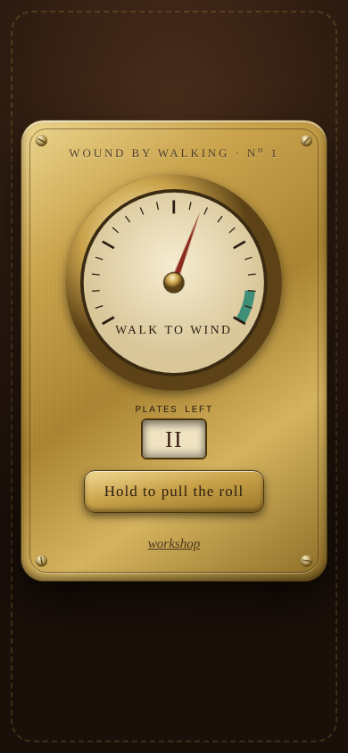

- One free plate at the start of each walk. Each later plate needs about 5 minutes of walking. Three per walk at most. **Yacoub.**
- 5 minutes is measured as about 500 steps, from the accelerometer, or about 360 m of GPS distance, whichever is further along. **Claude.**
  - GPS only counts walking pace (under about 2.4 m/s). A car or metro ride winds nothing.
  - Standing still doesn't count.
- The recharge must be felt, not just happen. **Yacoub.**
  - A brass pressure gauge, not a number. The needle climbs toward a green zone and trembles when the plate is ready. **Yacoub** asked for a skeuomorphic, steampunk gauge.
  - A ratchet click every fifth of the way. A valve hiss when a plate locks in. **Claude.**
  - The plate counter is a rolling paper wheel with Roman numerals, not digits. **Claude.**

### 2.6 The compass
- Appears on the plate only once you have at least one creature with a location. It points to the nearest one and counts paces. **Yacoub:** the compass is earned.

### 2.6b Ending the walk
- "Hold to end the walk" seals the roll, and you can do it any time after the first plate. The darkroom opens only from a separate "Enter the darkroom" button, so developing happens when you're home. **Yacoub** (13 Nov). v0 went straight into the darkroom from the street.
- Open: detect home automatically, for example by being back near where the roll was loaded.

### 2.7 The darkroom
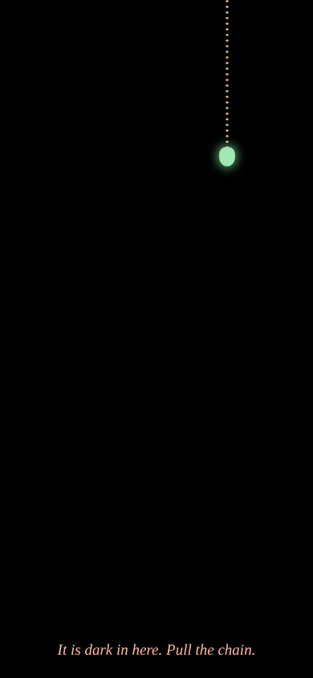 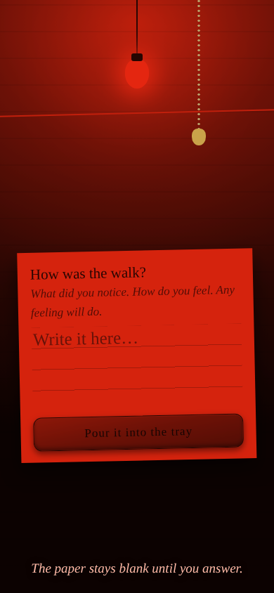 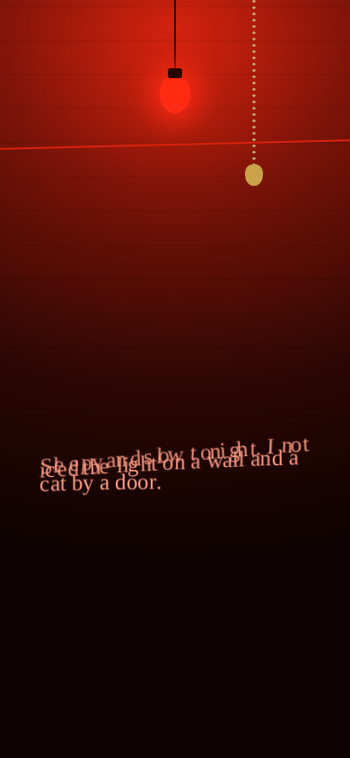
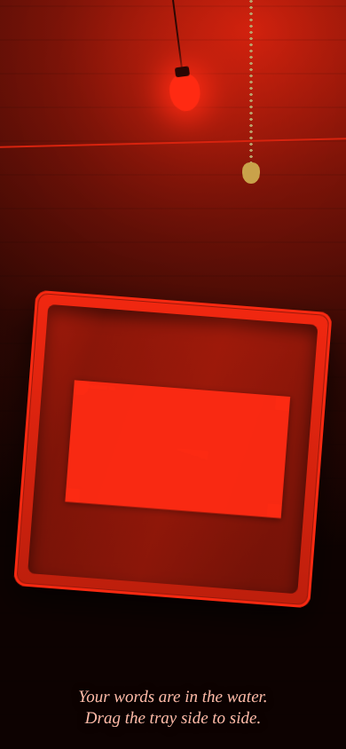 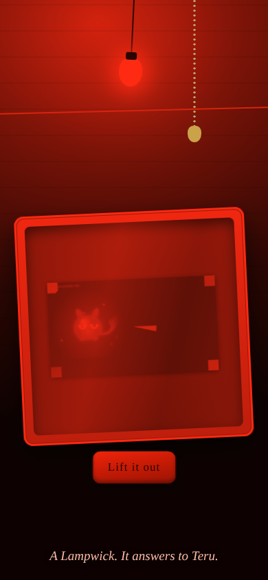 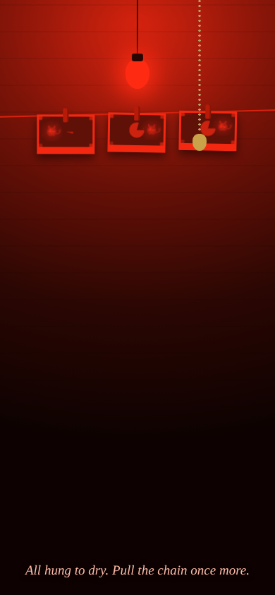 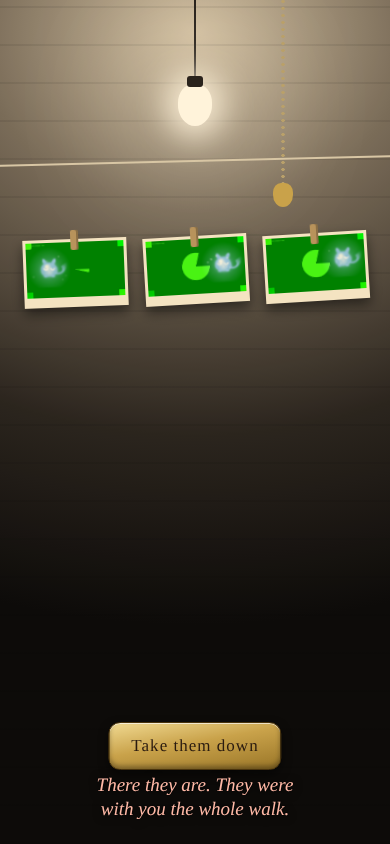

**Yacoub:** the darkroom is a place, and it's the reflection moment. Answering is what develops the photos. **Yacoub** left the look and feel to Claude ("surprise me"), so the sequence below is all **Claude**:

1. **Pitch dark.** Only the pull of a faintly glowing chain is visible. Pull it down, by dragging or tapping.
2. **Safelight.** The bulb flickers on and everything turns red. A low electrical hum.
3. **The slip.** A paper slip asks "How was the walk? What did you notice. How do you feel. Any feeling will do." The paper stays blank until you answer. Handwriting font, ruled lines.
4. **Pour.** Your words dissolve letter by letter and sink, blurred, into the tray. Your words are the developer.
5. **Rock the tray.** Tilt the phone side to side, or drag. The bulb sways with you, the liquid sloshes in sound and light, and the faster you rock the faster the image develops. About 3–6 s per plate with steady rocking, about 20 s without. **Yacoub** (13 Nov): v0 took too long. The photo rises first from pale grey.
6. **Eyes first.** The creature's eyes open before its body appears, so for a moment something is looking at you from the photo. They blink every few seconds.
7. **Lift it out.** It drips (three water notes) and is pegged to a line overhead with a wooden click. The next plate goes into the tray.
8. **Lights on.** Once all are hung, pull the chain again. White light, and the prints, which were grey in the red light, flood into colour. A chime, then: "There they are. They were with you the whole walk."

Reflection input is typing only in v0. iPhone keyboard dictation covers speaking. **Yacoub** wanted voice recording, typing, or a photographed handwritten page. Recording and the photographed page are cut from v0.

### 2.8 The drying line
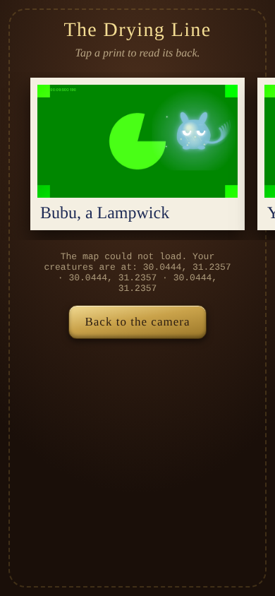 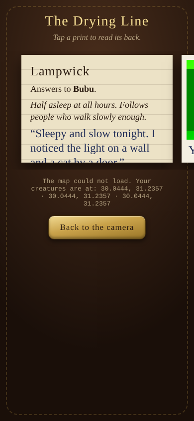

- A swipeable row of prints. Tap one to flip it over. The back holds the creature's kind, its name, its one-line lore, your reflection in handwriting, the date, the place, and who painted it. **Claude**, from the voice idea of words printed on the back of the photograph.
- A sepia map with a pin per creature, coloured by its mood. **Claude.**

---

## 3. Creatures

**Yacoub:** your reflection shapes the creature, and any feeling is valid, angry and sleepy included.

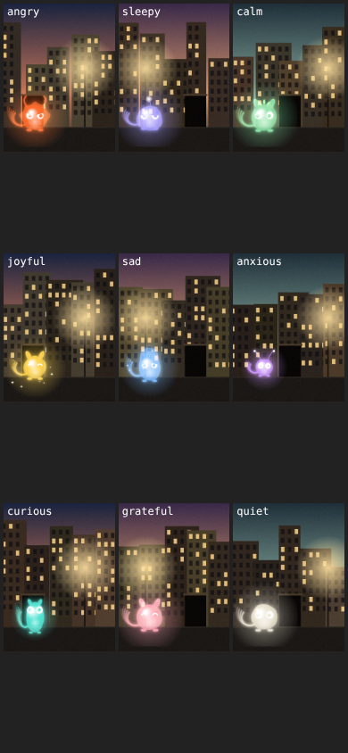

How it works in v0 (**Claude**):

1. **Mood.** The reflection is matched against word lists (English plus a few Egyptian Arabic words) to pick one of nine moods. The mood decides the creature kind.

| Mood | Kind | Colour | Look | Lore |
|---|---|---|---|---|
| angry | Cinderback | ember orange | spiky back, furrowed brow, horns | Keeps its back to the wall and its temper warm. |
| sleepy | Lampwick | violet | droopy wax body, heavy lids, a candle wick | Half asleep at all hours. |
| calm | Mosslight | moss green | round, leaf ears | Settles where someone stood still. |
| joyful | Sparrowspark | gold | bouncy, smiling eyes, sparkles | Can't keep still near someone pleased with their day. |
| sad | Raincoat | rain blue | teardrop, drooping eyes | Carries a little weather of its own. |
| anxious | Flitter | pale purple | tiny, wide eyes, antennae | Stays close to anyone who notices their breathing. |
| curious | Peerling | sea teal | tall, long neck, big eyes | Leans out of doorways. |
| grateful | Emberkin | rose pink | glowing belly | Warms its hands on small thanks. |
| quiet (nothing matched) | Hush | pale silver | smooth and simple | Shows up when nothing in particular is the matter. |

2. **What you noticed adds features.** Plants give leaves, water gives droplets, light gives sparkles, animals give ears, walls and doors give stone marks.
3. **Name.** Each creature gets a made-up name from syllables, the same every time for the same plate and words.
4. **Where it hides.** The camera picks the darkest, calmest patch in the lower two thirds of the photo. Creatures live in shadows and doorways.

This word-list approach is crude on purpose: it works offline and costs nothing. A better reader of the reflection, for example Claude reading it, is an open question.

---

## 4. Who paints the creature

Set in the workshop. Default: "best available".

| Painter | What it does | What leaves the phone | Status |
|---|---|---|---|
| Hugging Face, FLUX.1 Kontext [dev] | Paints the creature into the real photo | The photo | Wired, untested. Needs Yacoub's token (made 11 Nov) |
| Pollinations | Paints a creature from text, which is blended into the shadow | Mood plus up to five words | Wired, unverified. Text-to-image only |
| Clockwork | Draws the creature on the phone | Nothing | Tested. Always the fallback |

- Kontext was picked over thousands of text-to-image models because it edits an existing photo, which is the magic moment. **Claude.**
- The end goal stays non-generative, low-cost compositing. AI is a demo tool here. **Yacoub.**
- If a painter is slow, the photo develops fully and waits ("Something is taking shape. Keep rocking."). After 35 s it falls back to clockwork. **Claude.**

---

## 5. Look and sound

**Palette** (**Claude**): walnut `#140d08`, leather `#4a2e1c`, brass `#c9a24a` with highlight `#f3dc93`, parchment `#ead9b0`, ink `#2a1b10`, safelight red `#ff2a12`, verdigris green `#3f8f78` for "ready".

**Type** (**Claude**):
- IM Fell English and IM Fell English SC: old printed type, for the camera's voice.
- Special Elite: typewriter, for labels and data.
- Caveat: handwriting, for everything you write.

**Words:** the camera speaks one short italic line at a time at the bottom of the screen, and nothing else. **Claude.**

**Sound:** on iPhone, sound plays even with the silent switch on (Safari 17+), and the audio unlocks on every touch. v0 was silent on his phone. **Claude** (13 Nov fix, untested on a real phone).

Every sound is synthesised in the browser, with no audio files. **Claude.** Chime, creak, fold, ratchet, valve hiss, shutter, film advance, tuning-fork tone, safelight hum, tray slosh, pour, drip, peg.

**Assets:** no third-party art, 3D models or audio samples are used. The camera, gauge, darkroom and creatures are drawn in code. The build machine could not reach Sketchfab, Poly Haven or Freesound. Sourcing real assets is open.

---

## 5b. Tester
- A faint "tester" button sits bottom-left on every screen: start a new roll or erase everything, from anywhere, including mid-darkroom. **Yacoub** (13 Nov).
- Workshop → Sensor check shows live motion permission, tilt, steadiness and steps.

## 6. Saving

- The current roll and settings are saved in the browser's local storage, and plates (photo, location, creature) in the browser's database (IndexedDB). Closing the page mid-walk keeps the roll.
- Nothing is uploaded except to the painter you choose.
- Workshop → "Copy walk log" gives a text log of every walk to paste anywhere.
- Clearing Safari's website data erases everything. There is no cloud backup in v0.

---

## 7. Known limits of a web page

- The page sleeps when the phone is locked. Steps aren't counted then, and no sounds play in your pocket. GPS distance is credited when you reopen it.
- No haptics on iPhone Safari. **Yacoub** wanted vibration, so that's the first native-app feature.
- The iPhone ring switch must be on to hear sound.

---

## 8. Open questions

1. Who made the camera, and why only its photos show creatures? Partly answered by voice: a clockwork thing from another age that runs on walking, not electricity, so nobody rushing can use it. Not locked.
2. Mount length: 60 s, or Yacoub's original one to two minutes?
3. Is the word-list mood reader good enough, or should Claude read the reflection?
4. Should there be any sound during the walk itself, or is silence better?

## 9. Parked for v2

- Haptics (native app). **Yacoub.**
- A limited voice note during the walk, one minute per walk, printed on the back of a photo. **Yacoub.**
- Reflection by voice recording or a photographed handwritten page. **Yacoub.**
- Fog-of-war map over a game world, other players' creatures, creatures that grow on revisits, upgrade stores in real neighbourhoods, streaks as a tunable module, XP into Protagonist. From the July PRD and the October café rant.

## 10. Credits

- Typefaces: IM Fell English and IM Fell English SC by Igino Marini, Caveat by Impallari Type (SIL OFL), Special Elite by Astigmatic (Apache 2.0), via Google Fonts.
- Map: Leaflet by Volodymyr Agafonkin (BSD-2). Map data © OpenStreetMap contributors.
- Painters: Pollinations.ai; FLUX.1 Kontext [dev] by Black Forest Labs, through Hugging Face Inference Providers.
- Design references: Professor Layton (Level-5), Wii gesture play (Nintendo), wet-darkroom practice.
